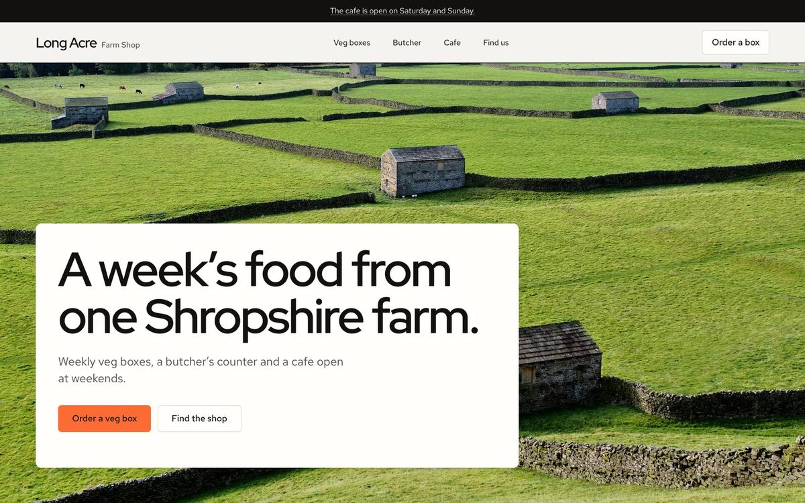
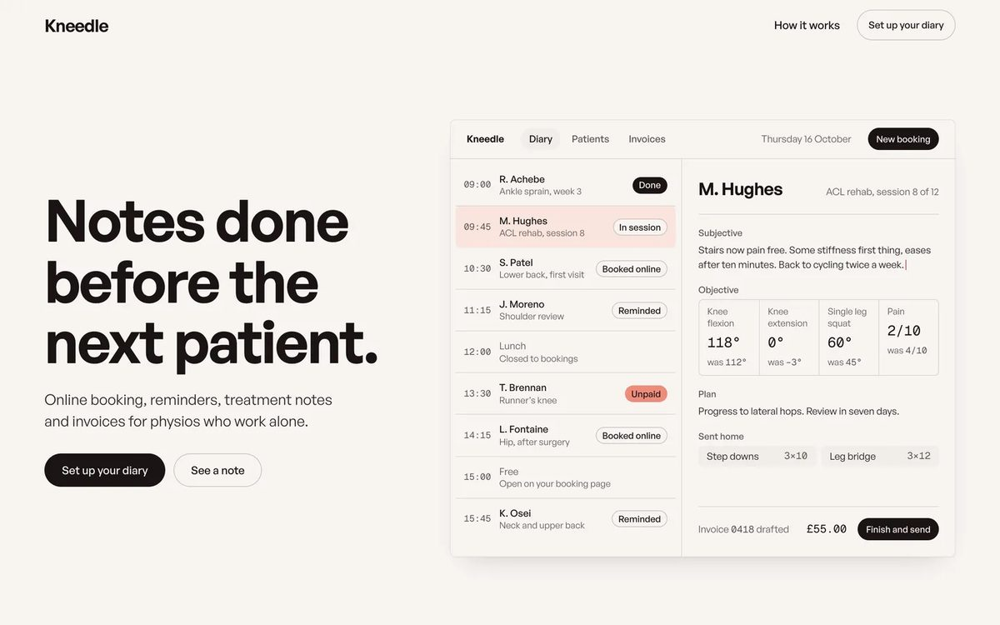
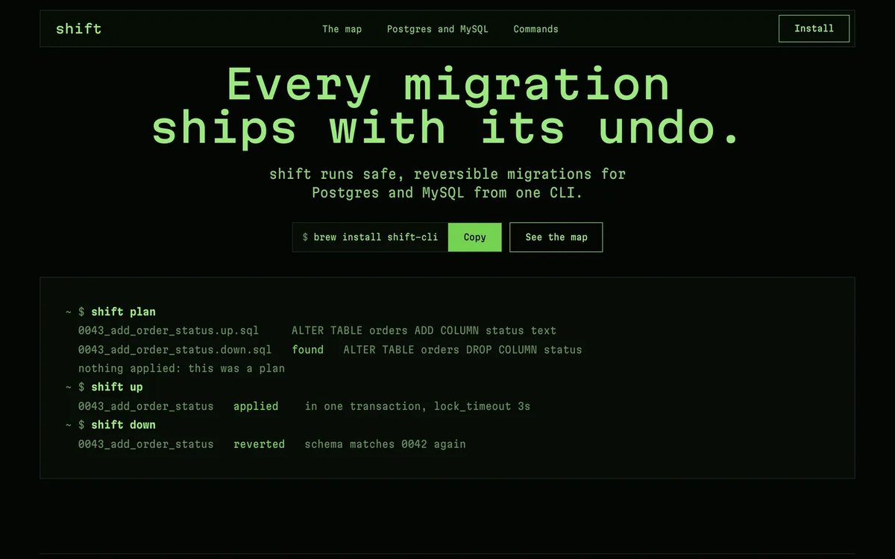
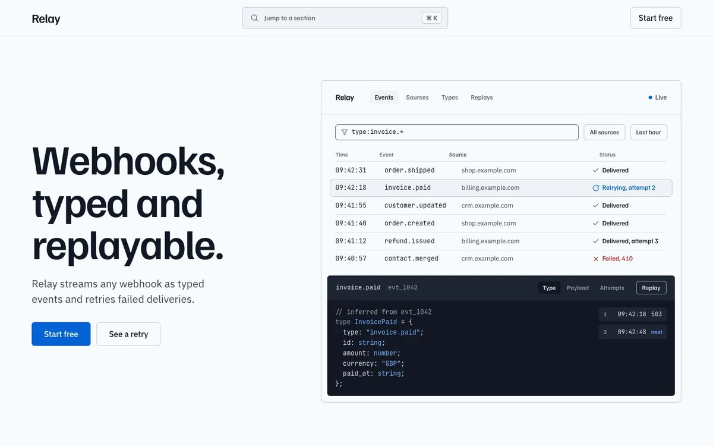
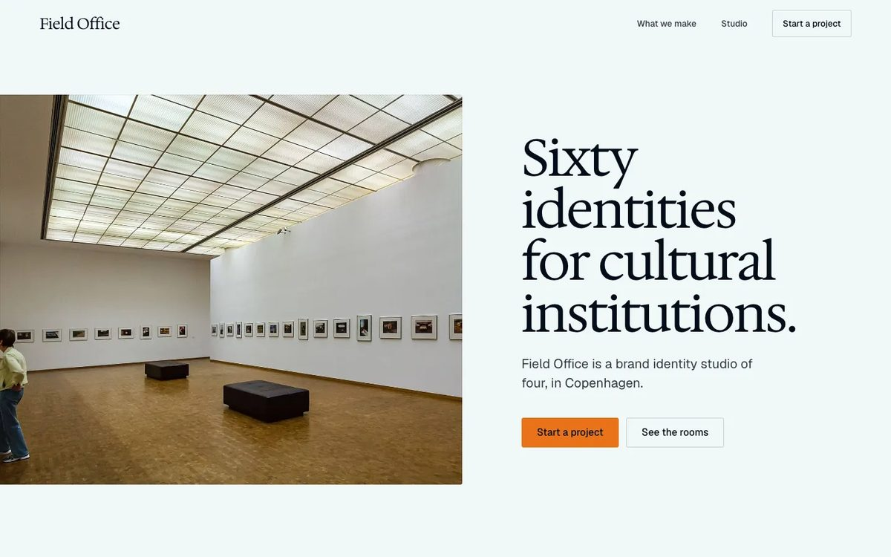
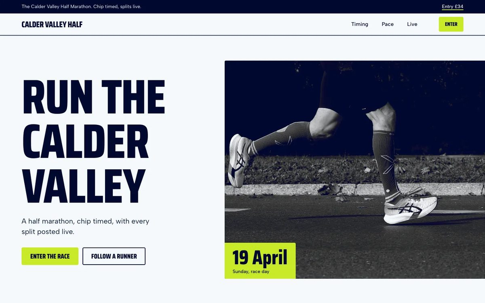

# Hallmark

**A design skill for Claude Code, Codex CLI and OpenCode that refuses to look AI-generated.**

[usehallmark.com](https://www.usehallmark.com) &nbsp;·&nbsp; forty-eight themes &nbsp;·&nbsp; custom on request &nbsp;·&nbsp; redesign and audit by name

Made by Together AI.

<p align="center">
  
</p>

Hallmark holds a hard floor and then gets out of the way. It deals three themes from a catalog of forty-eight materials, and a script applies the rotation so consecutive builds cannot converge. When the user asks for **custom** it steps further back: no theme and no plan, only the floor and a brief to make something it has never made before. It keeps every page to one idea per screen, set big enough to fill it. Then it lints the result against the tells that read as machine-made: the eyebrow above every heading, the small label in tracked capitals, the one coloured word in a headline, middle-dot meta strings, arrows glued to link text, mono labels as a technical costume, cream paper with a high-contrast serif and a clay accent, a page of empty picture frames, a page that is nothing but photographs, a heading and a line adrift on a wide canvas, a hero that stops short of its screen, one price said four times, a form that says thanks without sending anything, content that ships invisible when a script fails, text crammed against the edge of its box, and text painted under another element.

The gates come in tiers. The **Floor** never ships: contrast, focus, reduced motion, invented metrics, layout that breaks on a phone, a hero that misses the first screen, the eyebrow. **Reflex** gates are the defaults a language model falls into rather than laws, and a build with an argument may overrule one on the record, with the reason in the CSS stamp and the guard re-derived by the checker. **Finish** checks are craft detail that never blocks a ship. A fresh-context reviewer with no memory of the build gets the last word.

Two pages by Hallmark for two different briefs feel like different sites, not colour-swaps of the same template. The skill is built to stop a model looking generic, not to stop it being good.

## New in v2

- **Forty-eight themes.** Each is a material (paper, type, colour, surfaces, a way with photographs) with a picture of a finished page, and the build lays out its own page in it.
- **Custom.** Ask for a custom page and Hallmark designs from your brief alone, under the same rules and checks.
- **Your real product.** Point it at a URL, a dev server or an app folder and it runs the product and captures the screenshots itself.
- **Real photographs.** A library of 755 openly licensed photos, picked per subject, treated in the theme's way and credited on the page.
- **Redesign and audit.** `/hallmark redesign <path>` rebuilds an existing page and keeps its content and wiring; `/hallmark audit <path>` only reports.
- **A linter that looks.** `sloplint --render` opens the page at eight widths and measures the fold, contrast, spacing, photo balance and line breaks.

---

## What a build looks like

1. Pre-flight reads the project (fonts, palette, framework, a locked `design.md`).
2. One message asks for the material first (screenshots, photos, real numbers, a quote with a name), then audience, use and tone. Facts are never invented: a number, a quote or a logo nobody gave stays absent.
3. The page is designed from that inventory, then named; the signature is the strongest real thing shown at its best. `scripts/theme.mjs deal` prints three themes that fit the brief and clear the log.
4. Pictures come first: the user's own, screenshots of the real product that the build runs and captures itself (`scripts/capture.mjs`), the product built at full fidelity when there is nothing to capture yet, or photographs from a library of 755 verified, openly licensed photos from Wikimedia Commons that `scripts/theme.mjs photos` picks for each subject; the theme treats them in CSS (black and white, duotone in its inks, muted, natural) and the footer credits each one. Stand-ins sit in slots the user's own files replace. Pictures take a quarter to a third of the page, and the theme's own material carries the sections between them. Hallmark never draws an illustration, never leaves an empty box where a picture belongs, and never counts with rows of marks.
5. The build loads the layout, imagery and craft files, one genre file, one theme file (a material: palette, faces, surfaces, controls and its range without a photograph, never a component) with its picture (a finished page in that theme, for finish, never composition) and the gate table. The layout file sets the canvas, the type steps, how a section fills its width and how the hero fills its screen. `scripts/theme.mjs scaffold` writes `tokens.css` and `base.css`, so the page starts with the Floor already in place.
6. A Picks block states every decision once. A short patterns file shows how controls, slots, forms and reveals are written to pass the gates, without a whole page to copy.
7. The nav and hero are built alone first, rendered at four sizes and reviewed cold before the rest of the page exists.
8. `scripts/sloplint.mjs --render` runs the mechanical gates at 320 to 1920 wide, the model walks the judged ones, and a subagent reviews the finished page cold.

Each page is self-contained HTML and CSS, stamped in its first CSS comment with the shape, theme, chrome, hero and signature move it took.

---

## Different briefs, different shapes

<table>
  <tr>
    <td width="25%"><a href="https://www.usehallmark.com/made/darkroom-photographer/"></a></td>
    <td width="25%"><a href="https://www.usehallmark.com/made/furrow-farm-shop/"></a></td>
    <td width="25%"><a href="https://www.usehallmark.com/made/coral-physio-booking/"></a></td>
    <td width="25%"><a href="https://www.usehallmark.com/made/terminal-migrations-cli/"></a></td>
  </tr>
  <tr>
    <td><b>Ines Calvo</b><br/><sub>Documentary photographer, Darkroom</sub></td>
    <td><b>Long Acre Farm Shop</b><br/><sub>Farm shop, Furrow</sub></td>
    <td><b>Kneedle</b><br/><sub>Physio booking app, Coral</sub></td>
    <td><b>shift</b><br/><sub>Migrations CLI, Terminal</sub></td>
  </tr>
  <tr>
    <td width="25%"><a href="https://www.usehallmark.com/themes/hedgerow/"></a></td>
    <td width="25%"><a href="https://www.usehallmark.com/themes/cobalt/"></a></td>
    <td width="25%"><a href="https://www.usehallmark.com/themes/studio/"></a></td>
    <td width="25%"><a href="https://www.usehallmark.com/themes/sport/"></a></td>
  </tr>
  <tr>
    <td><b>Five Mile Gin</b><br/><sub>Gin distillery, Hedgerow</sub></td>
    <td><b>Relay</b><br/><sub>Webhook API, Cobalt</sub></td>
    <td><b>Field Office</b><br/><sub>Identity studio, Studio</sub></td>
    <td><b>Calder Valley Half</b><br/><sub>Half marathon, Sport</sub></td>
  </tr>
</table>

Every page here was built by Hallmark in one run from a one-sentence brief; the top row are client briefs, the bottom row the pages that picture four of the forty-eight themes. Open any of them on [usehallmark.com](https://www.usehallmark.com).

---

## Themes

A theme is a material, not a plan: paper, ink, faces, rule weight, radius, shadow stance, texture budget, motion character, voice, and its range: what the material makes without a photograph. It never says what a page contains or in what order, so two pages in one theme do not share a section sequence. Every theme is one file of at most 8 KB in [`references/themes/`](skills/hallmark/references/themes/) with a header block that `theme.mjs index` compiles into `index.json`, and a picture beside it: two screens of a finished page built in that theme, so a build sees the material at full size before it writes a line. The deal reads the index and a build reads exactly one theme file, so the size of the catalog costs a build nothing.

## Custom

When the user asks for **custom** ("bespoke", "no theme", "a world of its own"), Hallmark hands the whole design to the model: no theme, no page shape, no section list, no components, no palette recipe. It keeps the floor, the gates against machine-made pages and the sweep, and gives one short brief in [`direction.md`](skills/hallmark/references/direction.md): learn what only this client has, set aside the page you would make anyway, find one idea and let it run the whole page, and make it unique and clean. Clean means exact, not empty, and pictures appear only when the subject has something to show.

---

## One skill, three harnesses

The same SKILL.md, references, gates and scripts run in **Claude Code**, **Codex CLI** and **OpenCode**; [`flow.md`](skills/hallmark/references/flow.md) § Harnesses carries the per-harness tuning. The mechanically checkable gates live in a zero-dependency checker that reads HTML and CSS, React, Vue, Svelte and Astro components and their Tailwind classes, and with `--render` the page itself at eight widths from 320 to 1920 (or a running dev server with `--url`):

```
node skills/hallmark/scripts/sloplint.mjs <file-or-dir> --genre <genre> --render
```

One command installs a lean copy (skill, references, scripts, never the marketing site) everywhere it belongs. On the way it rebuilds the theme index, validates every theme and runs `scripts/refcheck.mjs`, which reads every reference file for dead links, missing sections, retired gate numbers, unknown tokens, stale stamps and sample copy that breaks a gate, lints four complete pages (one per genre) that must pass every gate, and checks that the deliberately broken fixtures still fail; the install stops if it finds a problem:

```bash
node skills/hallmark/scripts/install.mjs
```

| Harness | Install location | Invoke |
| --- | --- | --- |
| Claude Code | `~/.claude/skills/hallmark` | `/hallmark <brief>`, `/hallmark redesign <path>`, or describe a new build |
| Codex CLI | `~/.agents/skills/hallmark` | `$hallmark <brief>`, `$hallmark redesign <path>`, or describe a new build |
| OpenCode | auto-discovers the copies above | `/hallmark <brief>`, `/hallmark redesign <path>`, or describe a new build |

On Claude Code, `node skills/hallmark/scripts/install-hook.mjs` wires the Floor gates into a PostToolUse hook so a failing artifact is reported the moment it is written; the taste gates wait for the end-of-build sweep, so the hook never nags. `--global`, `--print` and `--remove` do what they say.

---

## Redesign

Hallmark runs by itself when you ask for something new. It never starts on a page, a site or an app that already exists: ask your agent for new colours, a restyle or a redesign without naming Hallmark and it does the job the ordinary way. For a full redesign by Hallmark, say the verb:

```
/hallmark redesign ./src/app
/hallmark audit ./index.html
```

A redesign keeps what the page says and does and changes how it looks and how it is laid out. Two lighter depths run only when you ask for them in the same request:

| Depth | Stays | Changes | Say |
| --- | --- | --- | --- |
| **full** | the content and the wiring | the system and the composition | the verb alone |
| **restyle** | the layout | colour, type, radius, shadow, motion, the controls | *keep the layout* |
| **polish** | the system and the layout | only what reads as generated: the tells, contrast, states, motion | *polish* |

Before it touches anything, `sloplint --before` lints the page and records every link, form field, handler, test hook, heading and figure. After the build, `sloplint --kept` fails the redesign if any of them went missing, a fresh-context reviewer compares the new screens with the old ones, and the project's own build and tests have to pass. The handoff is a before and after: findings, what was kept, what changed, anything dropped with the reason on the record, and `.hallmark/compare.html`, the old and new screens side by side. `audit` stops after the report and edits nothing.

Dashboards, admin screens and tools are app screens: the landing-page rules (hero, fold, section rhythm) step aside and density, tables and the four data states take over. Small edits to an existing design are not Hallmark runs; the edit-time hook above keeps the Floor on them in the background.

---

## Install

```
npx skills add nutlope/hallmark
```

Re-run any time to update. Worked examples in [`docs/recipes.md`](docs/recipes.md).

- **One harness only:** `npx skills add nutlope/hallmark --agent claude-code` (or `codex`, `opencode`, `cursor`, `github-copilot`).
- **By hand:** copy the whole [`skills/hallmark/`](skills/hallmark/) folder (`SKILL.md`, `references/` and `scripts/` together) into your harness's skills folder: `~/.claude/skills/`, `~/.agents/skills/`, or `.cursor/skills/` in a project. Any harness that reads Agent Skills can run it; Claude Code, Codex CLI and OpenCode are the three it is tuned and tested on.
- **If it does not fire on its own,** name it: *use hallmark to build ...*. Smaller models rarely pick up a skill unprompted.
- **Models:** the flow leans on long instructions, tool calls and, for the reviews, subagents. It is tuned on current Claude and GPT models; small local models tend to stall partway.

---

## Licence

MIT. Use it, fork it, ship it.

The photo library (`skills/hallmark/scripts/photos.json`) lists photographs hosted on Wikimedia Commons; it holds no image files. Each photo keeps its own licence (CC0, public domain, CC BY or CC BY-SA), recorded with its author and source page. CC BY and CC BY-SA require a credit, which Hallmark writes into every page that uses one (`references/imagery.md` § 2). Hallmark does not use stock sites (Unsplash, Pexels, Pixabay), whose terms bar AI tools from picking their images.
