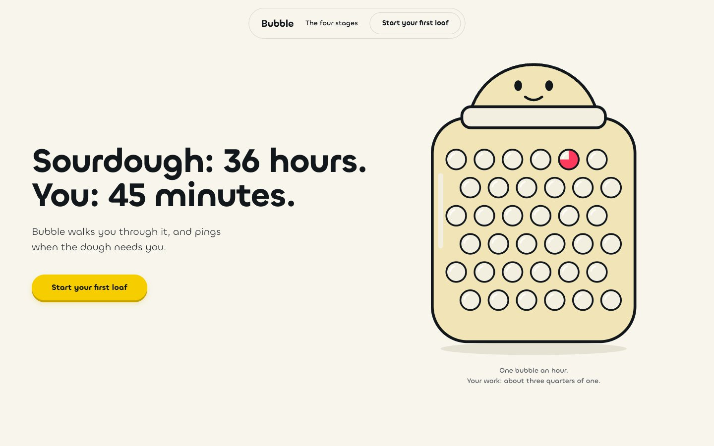
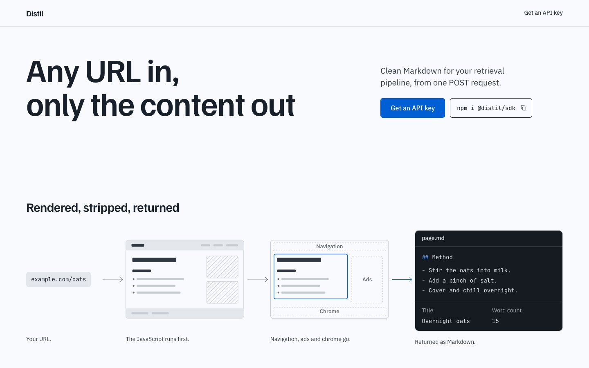
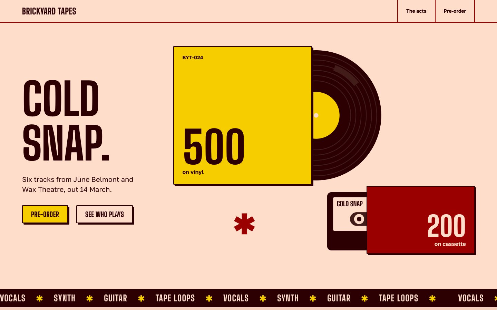
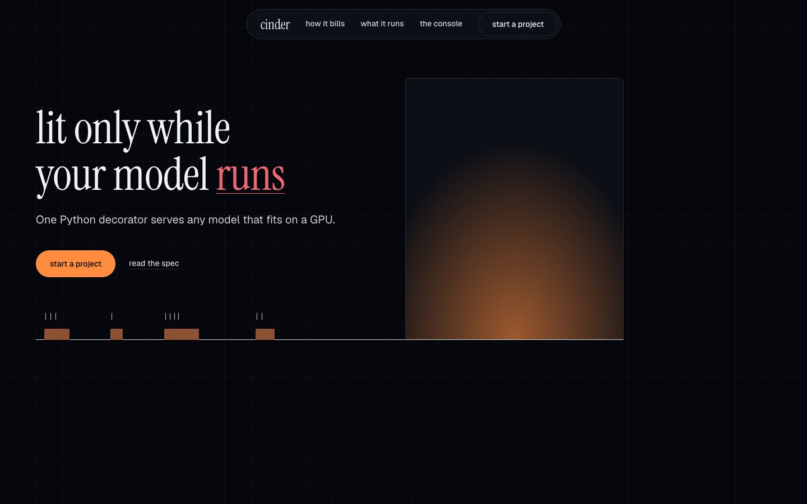
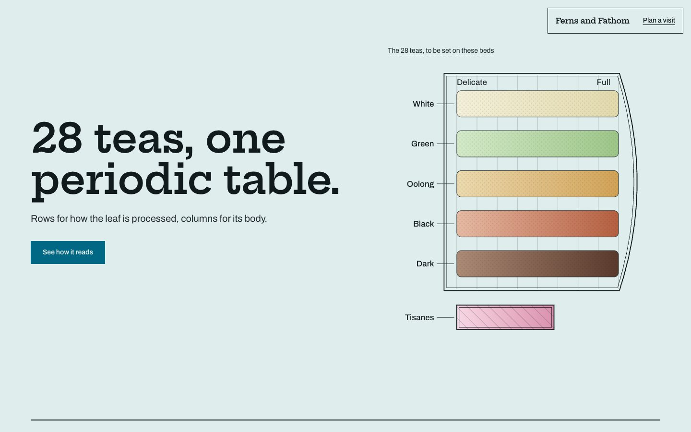
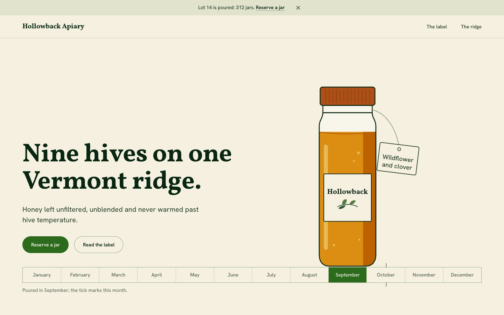
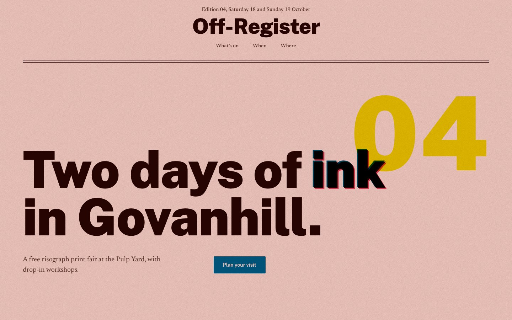
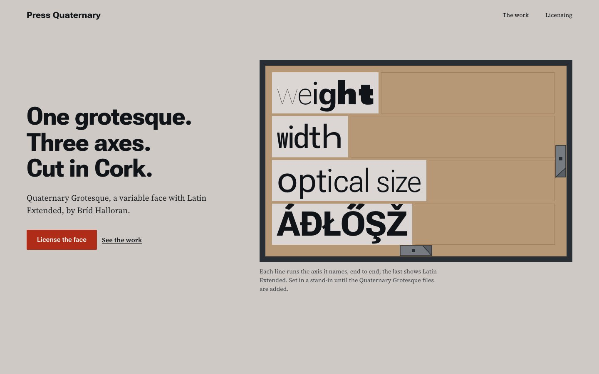

# Hallmark

**A design skill for Claude Code, Codex CLI and OpenCode that refuses to look AI-generated.**

[Live demo](https://www.usehallmark.com) &nbsp;·&nbsp; forty-nine themes, dealt three at a time &nbsp;·&nbsp; a custom world on request &nbsp;·&nbsp; press `T` to cycle.

Made by Together AI.

<p align="center">
  
</p>

Hallmark holds a hard floor and then gets out of the way. It deals three themes from a catalog of forty-nine materials, and a script applies the rotation so consecutive builds cannot converge. When the user asks for **custom** it derives a world made to measure, with an outside draw picking among grounded directions so the model cannot repeat its favourite. It keeps every page to one idea per screen. Then it lints the result against the tells that read as machine-made in 2026: the eyebrow above every heading, the small label in tracked capitals, the one coloured word in a headline, middle-dot meta strings, arrows glued to link text, mono labels as a technical costume, cream paper with a high-contrast serif and a clay accent, a page of empty picture frames, one price said four times, a form that says thanks without sending anything, and content that ships invisible when a script fails.

The gates come in tiers. The **Floor** never ships: contrast, focus, reduced motion, invented metrics, layout that breaks on a phone, the fold at three widths, the eyebrow. **Reflex** gates are the defaults a language model falls into rather than laws, and a build with an argument may overrule one on the record, with the reason in the CSS stamp and the guard re-derived by the checker. **Finish** checks are craft detail that never blocks a ship. A fresh-context reviewer with no memory of the build gets the last word.

Two pages by Hallmark for two different briefs feel like different sites, not colour-swaps of the same template. The skill is built to stop a model looking generic, not to stop it being good.

---

## What a build looks like

1. Pre-flight reads the project (fonts, palette, framework, a locked `design.md`).
2. One message asks for the material first (screenshots, photos, real numbers, a quote with a name), then audience, use and tone. Material is never invented: what was not given becomes a designed slot or stays absent.
3. The page is designed from that inventory, then named; the signature move comes from the strongest real thing. `scripts/theme.mjs deal` prints three themes that fit the brief and clear the log.
4. The build loads one craft file, one genre file, one theme file with its picture (a finished page in that theme, for scale and density, never composition) and the gate table. `scripts/theme.mjs scaffold` writes the tokens and prints the base rules.
5. A Picks block states every decision once. One exemplar page for the genre is read for craft.
6. The nav and hero are built alone first, rendered at four sizes and reviewed cold before the rest of the page exists.
7. `scripts/sloplint.mjs --render` runs the mechanical gates at 320 to 1920 wide, the model walks the judged ones, and a subagent reviews the finished page cold.

Each page is self-contained HTML and CSS, stamped in its first CSS comment with the shape, theme, chrome, hero and signature move it took.

---

## Different briefs, different shapes

<table>
  <tr>
    <td width="25%"><a href="https://www.usehallmark.com/examples/hum-07/"></a></td>
    <td width="25%"><a href="https://www.usehallmark.com/examples/cobalt-01/"></a></td>
    <td width="25%"><a href="https://www.usehallmark.com/examples/carnival-01/"></a></td>
    <td width="25%"><a href="https://www.usehallmark.com/examples/lumen-01/"></a></td>
  </tr>
  <tr>
    <td><b>Bubble</b><br/><sub>Sourdough app · Hum</sub></td>
    <td><b>Distil</b><br/><sub>Extraction API · Cobalt</sub></td>
    <td><b>Cold Snap</b><br/><sub>Record label · Carnival</sub></td>
    <td><b>Cinder</b><br/><sub>GPU inference · Lumen</sub></td>
  </tr>
  <tr>
    <td><a href="https://www.usehallmark.com/examples/custom-03/"></a></td>
    <td><a href="https://www.usehallmark.com/examples/garden-01/"></a></td>
    <td><a href="https://www.usehallmark.com/examples/riso-01/"></a></td>
    <td><a href="https://www.usehallmark.com/examples/press-01/"></a></td>
  </tr>
  <tr>
    <td><b>Ferns &amp; Fathom</b><br/><sub>Tea menu · Custom</sub></td>
    <td><b>Hollowback Apiary</b><br/><sub>Honey farm · Garden</sub></td>
    <td><b>Off-Register</b><br/><sub>Print fair · Riso</sub></td>
    <td><b>Press Quaternary</b><br/><sub>Type studio · Custom</sub></td>
  </tr>
</table>

The fifteen featured examples on [usehallmark.com](https://www.usehallmark.com) were rebuilt with v2.3, one run each from a fixed brief, and lint clean; their sources are in [`site/examples/`](site/examples/). The other pages there and the test pages under [`site/_tests/`](site/_tests/) predate v2.

---

## Themes

A theme is a material, not a plan: paper, ink, faces, rule weight, radius, shadow stance, texture budget, motion character, voice. It never says what a page contains or in what order, so two pages in one theme do not share a section sequence. Every theme is one file of four to seven kilobytes in [`references/themes/`](skills/hallmark/references/themes/) with a header block that `theme.mjs index` compiles into `index.json`, and a picture beside it: two screens of a finished page built in that theme, so a build sees the material at full size before it writes a line. The deal reads the index and a build reads exactly one theme file. Forty-nine themes cost a build what twenty-three did.

## Custom

When the user asks for **custom** ("derive it", "bespoke", "no theme"), Hallmark leaves the catalog and designs the page from scratch: it names and rejects the category's reflex aesthetics, writes a slate of seven grounded directions, and a deterministic draw (`scripts/seed.mjs`) picks which one gets built while dealing three challengers from a curated atlas of complete design systems, each judged on audience identification and product clarity. A scene sentence sets the light, a colour posture sets how far the palette commits, `theme.mjs check` refuses any coordinate the catalog already occupies, and a five-block direction contract written into the artifact gets audited promise by promise before shipping. The protocol lives in [`direction.md`](skills/hallmark/references/direction.md).

---

## One skill, three harnesses

The same SKILL.md, references, gates and scripts run in **Claude Code**, **Codex CLI** and **OpenCode**; [`flow.md`](skills/hallmark/references/flow.md) § Harnesses carries the per-harness tuning. The mechanically checkable gates live in a zero-dependency checker that reads HTML and CSS, React, Vue, Svelte and Astro components and their Tailwind classes, and with `--render` the page itself at seven widths (or a running dev server with `--url`):

```
node skills/hallmark/scripts/sloplint.mjs <file-or-dir> --genre <genre> --render
```

One command installs a lean copy (skill, references, scripts, never the marketing site) everywhere it belongs. On the way it rebuilds the theme index and runs `scripts/refcheck.mjs`, which reads every reference file for dead links, missing sections, retired gate numbers, unknown tokens, stale stamps and sample copy that breaks a gate, and lints the four exemplar pages, which must pass every gate they teach; the install stops if it finds one:

```bash
node skills/hallmark/scripts/install.mjs
```

| Harness | Install location | Invoke |
| --- | --- | --- |
| Claude Code | `~/.claude/skills/hallmark` | `/hallmark <brief>` or just describe the build |
| Codex CLI | `~/.agents/skills/hallmark` | `$hallmark <brief>` or implicit |
| OpenCode | auto-discovers the copies above | `/hallmark <brief>` or implicit |

On Claude Code, `node skills/hallmark/scripts/install-hook.mjs` wires the Floor gates into a PostToolUse hook so a failing artifact is reported the moment it is written; the taste gates wait for the end-of-build sweep, so the hook never nags. `--global`, `--print` and `--remove` do what they say.

---

## The verbs

Auditing a page, redesigning one, studying a reference and dealing variants are separate skills (`/audit`, `/redesign`, `/study`, `/variants`) in a companion pack that installs beside Hallmark and reads its gates and craft files, so they never drift from the build skill. Hallmark itself does one job: build.

---

## Install

```
npx skills add nutlope/hallmark
```

Re-run any time to update, or copy [`SKILL.md`](skills/hallmark/SKILL.md), [`references/`](skills/hallmark/references/) and [`scripts/`](skills/hallmark/scripts/) into your harness's skills folder. Worked examples in [`docs/recipes.md`](docs/recipes.md).

---

## Licence

MIT. Use it, fork it, ship it.
